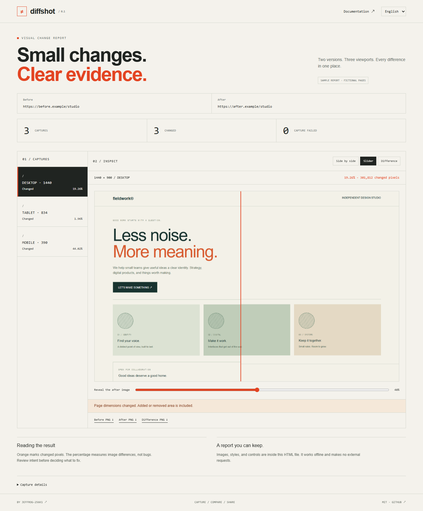

# Diffshot

[English](README.md) · [한국어](README.ko.md) · [简体中文](README.zh-CN.md) · [日本語](README.ja.md) · [Español](README.es.md)

**2つの URL、3つの画面サイズ。共有できる1つのレポート。**

[サンプルレポートを開く](https://jeffrog-256k1.github.io/diffshot/?lang=ja)

[](https://jeffrog-256k1.github.io/diffshot/?lang=ja)

Diffshot はウェブページの2つのバージョンを比較し、見た目の違いを示すオフライン HTML を生成します。視覚回帰サービスを設定せずに UI の変更を説明できます。公開デモは架空のページの結果であり、訪問者が指定した URL を取得するサービスではありません。

## ローカル実行

Node.js 22.12 以降と npm が必要です。アカウント・サーバー・有料 API は不要です。npm パッケージは未公開のため、クローンしたリポジトリで実行してください。

```sh
git clone https://github.com/jeffrog-256k1/diffshot.git
cd diffshot
npm ci
npx playwright install chromium
```

## ページを比較

```sh
npm run compare -- http://127.0.0.1:3000 http://127.0.0.1:4000 --out reports/review-01 --lang ja
```

下記のループバック URL を自分のページや信頼できる公開サイトに置き換えます。`reports/review-01/index.html` をブラウザーで開いてください。画像・スタイル・操作機能を内蔵しているので、この1ファイルだけで共有できます。個別 PNG と画像を含まないメタデータ `report.json` も出力します。既存フォルダーは上書きしないため、毎回新しい `--out` パスを指定します。

## 機能

- デスクトップ 1440×900、タブレット 834×1112、モバイル 390×844。新しい Chromium コンテキスト、倍率1、UTC、en-US、ライトテーマで取得。
- 画面幅を基準に高さ 8000px まで取得。横方向のはみ出しは表示しますが、画面幅の外側は画像に含めません。
- 左右比較、ドラッグスライダー、オレンジの差分、PNG ダウンロード。追加・削除された白い空白領域も差分に含めます。
- 入力エラー、HTTP・移動失敗、マスク対象の不足を正常な比較と区別。一部の取得失敗もレポートに残します。
- レポートと README は英語・韓国語・簡体字中国語・日本語・スペイン語に対応。`--lang` は CLI の状態・エラーも切り替えます。引数名と詳細ヘルプは英語です。

## オプション

| オプション  | 意味                                           |
| ----------- | ---------------------------------------------- |
| `--out`     | 新しい出力フォルダー。存在する場合は中止。     |
| `--path`    | 最大5パスまで繰り返し指定。                    |
| `--mask`    | CSS セレクター最大10個。各ページで一致が必要。 |
| `--ready`   | 要素の表示とフォントの準備を待機。             |
| `--timeout` | 取得操作ごと 1000〜60000ms、既定15000。        |
| `--delay`   | 準備後 0〜5000ms、既定200。                    |
| `--lang`    | en, ko, zh-CN, ja, es。既定 en。               |

`--path` は両方の URL のパスを置き換えます。省略すると指定 URL をそのまま使用します。クエリは取得に使えますが、レポートのメタデータでは伏せます。フラグメントは省きます。パスと画像内容は匿名化しません。

```sh
npm run compare -- http://127.0.0.1:3000 http://127.0.0.1:4000 --path / --path /about --mask .clock --ready main --out reports/review-02 --lang ja
```

## 結果の読み方

終了コード0は取得成功と保存完了で、画像に変更があっても0です。1は取得失敗あり、2は入力・環境・書き込みエラー。自動で合否を決める CI ゲートではなく、レビュー用ツールです。割合はピクセルの違いで、不具合の深刻度ではありません。アンチエイリアスの差は除外し、pixelmatch の色のしきい値は0.1です。

## 制約とプライバシー

取得時にアニメーション・カーソルを無効にし、動きを減らす設定を指定します。ただし日時・動的コンテンツ・動画・非同期データ・OS のフォントは変わる場合があります。動的領域に `--mask`、準備条件に `--ready` を使えますが、完全な再現性は保証しません。ログイン状態の取り込み、クロール、AI 説明、自動 PR コメントは対象外です。対象の JavaScript が動くため、信頼できるページだけを使ってください。共有前に画像内の非公開情報を確認してください。自動アップロードは行いません。

## 開発と検証

```sh
npm test
npm run build
npm run test:browser
npm run dev
```

架空の例は `npm run demo:capture` と `npm run build` で再生成。インストール済み Chrome は `DIFFSHOT_BROWSER_CHANNEL=chrome` で指定します。Linux は `npx playwright install --with-deps chromium` を使用できます。同一画面、CSS・高さの変更、マスク、HTTP 失敗、終了コード、上書き防止、HTML 挿入、オフライン出力、5言語、モバイルを検証します。

[CONTRIBUTING](CONTRIBUTING.md) · [SECURITY](SECURITY.md) · [CHANGELOG](CHANGELOG.md)

## ライセンス

MIT。生成レポートは利用できますが、取得したページのコンテンツの権利は元の権利者に帰属します。

[LICENSE](LICENSE) · [Third-party notices](THIRD_PARTY_NOTICES.md)

[jeffrog-256k1](https://github.com/jeffrog-256k1) · [leejungjae.app](https://leejungjae.app)
